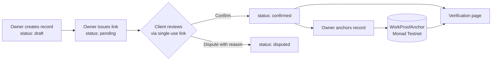
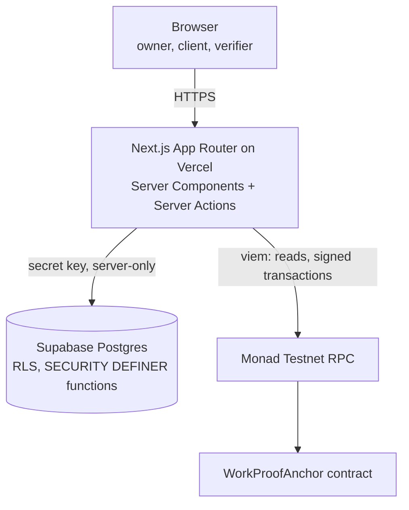

# WorkProof

**Client-confirmed work records for freelancers, with tamper-evident anchoring on Monad Testnet.**

WorkProof helps a freelancer keep a portable history of completed work that other people can check. The freelancer records a project, the client confirms or disputes it through a private single-use link, and a confirmed record can be anchored on Monad Testnet so that anyone holding its verification link can see whether the record has changed since it was confirmed.

Built for the Monad Metropolis Hackathon.

| | |
| --- | --- |
| Live application | <https://workproof-pied.vercel.app> |
| Repository | <https://github.com/FarhanFK2003/workproof> |
| Network | Monad Testnet (chain ID `10143`) |
| WorkProofAnchor contract | [`0x567B4F8b1E2A632140D295B3D7c73563F481026f`](https://testnet.monadscan.com/address/0x567B4F8b1E2A632140D295B3D7c73563F481026f) |

The landing page is public. The dashboard and record pages require the owner's passcode. Confirmation pages (`/confirm/…`) and verification pages (`/verify/…`) open only with a valid link issued by the application.

## Contents

- [The problem](#the-problem)
- [What WorkProof does](#what-workproof-does)
- [How it works](#how-it-works)
- [Architecture](#architecture)
- [Privacy and security](#privacy-and-security)
- [Smart contract and verification](#smart-contract-and-verification)
- [Technology stack](#technology-stack)
- [Running locally](#running-locally)
- [Environment variables](#environment-variables)
- [Testing](#testing)
- [Deploying to Vercel](#deploying-to-vercel)
- [Limitations and possible improvements](#limitations-and-possible-improvements)
- [Project status](#project-status)
- [Contributing](#contributing)
- [License](#license)

## The problem

Freelancers are usually judged on past work, but most portfolios are self-reported. A case study or a line on a CV says what the freelancer claims to have delivered; a new client has no easy way to check it, and references take time to collect and are hard to verify later. Records kept on a marketplace platform rarely leave that platform.

WorkProof adds two things to a work claim:

1. **Client confirmation.** The client reviews the project details and either confirms them or disputes them with a reason. This is the trust mechanism: it shows that someone holding the client's link agreed with the description.
2. **Integrity evidence.** A fingerprint of the confirmed record is written to Monad Testnet. Anyone with the verification link can check that the published record still matches what was confirmed and anchored.

These do not prove that the work was completed to a standard, that the client's identity was independently verified, or that any payment was made. WorkProof makes a claim harder to quietly alter after the fact and shows who confirmed it; it does not make a claim true.

## What WorkProof does

**Work records.** The owner (the freelancer running the deployment) creates records with a title, category, summary, deliverables, project dates, the client's details, and an optional amount. Records start as drafts. Validation runs on the server and is mirrored by database constraints.

**Client confirmation links.** For each record the owner generates a confirmation link and shares it with the client personally. WorkProof does not send email. Links are single-use, expire after 14 days, and generating a new link invalidates the previous unused one. The full link is shown to the owner only once.

**Confirm or dispute.** The client opens the link without an account or wallet, reviews the details, enters their name, and either confirms or disputes. A dispute requires a reason of at least 10 characters. The decision and the link's consumption are recorded in a single database transaction, so a link cannot be answered twice.

**Owner sign-in.** A single owner signs in with a passcode and receives a signed, time-limited session cookie. Failed sign-ins are rate-limited.

**Monad Testnet anchoring.** For a confirmed record, the owner can anchor a salted commitment and a content hash to the WorkProofAnchor contract. The server signs and sends the transaction; the owner never needs a browser wallet. Draft, pending, and disputed records cannot be anchored, which is enforced both in the application and in the database.

**Public verification.** Each anchored record has a verification link. The page shows the record's public details, recomputes its fingerprint, reads the anchor from Monad Testnet, and reports whether they match. Visitors can also download the canonical record document and check it themselves.

**Minimal on-chain data.** The contract stores only two opaque 32-byte values and a timestamp per record. Names, emails, amounts, and confirmation tokens are never written on-chain.

## How it works

1. **Create.** The owner creates a work record. It is saved as a `draft`.
2. **Share.** The owner generates a confirmation link and sends it to the client by any channel they choose. The record moves to `pending`.
3. **Decide.** The client opens the link, reviews the details, and confirms or disputes. The record becomes `confirmed` or `disputed`, and the link is consumed.
4. **Store.** The record, the confirmation request (stored as a token hash), and the client's decision live in Supabase.
5. **Anchor.** For a `confirmed` record, the owner clicks **Anchor to Monad testnet**. The server builds the canonical document, computes the commitment and content hash, and calls `anchor(commitment, contentHash)` on the contract.
6. **Verify.** The verification page rebuilds the document from the stored record, compares its hash with the stored and on-chain values, and reports the result.



### Three layers of data

| Layer | Where it lives | Who can see it |
| --- | --- | --- |
| Application data: all record fields, including client name, email, and amount | Supabase, read only by the server | The owner |
| Canonical record document: the public fields plus a random salt | Rebuilt by the server on demand; downloadable from the verification page | Anyone with the verification link |
| On-chain anchor: commitment, content hash, timestamp | WorkProofAnchor contract on Monad Testnet | Everyone, permanently |

The canonical document (`workproof-record-v1`) contains the record ID, salt, title, category, summary, deliverables, project start and end dates, client organization, and confirmation time. It is serialized as JSON with sorted keys, no whitespace, Unicode NFC normalization, and whole-second UTC timestamps, so the same record always produces the same bytes.

- `contentHash = SHA-256(canonical document)`
- `commitment = SHA-256("workproof-record-commitment-v1|" + recordId + "|" + salt)`

The salt is 128 random bits generated when a record is first anchored. It doubles as the verification key in `/verify/<key>`, so the verification link is effectively a bearer link: anyone who has it can view the record's public fields.

## Architecture



- **Next.js application.** Pages are React Server Components; writes go through Server Actions. Every module that touches secrets imports `server-only`, so it cannot be bundled into client code. With Cache Components enabled, pages are partially prerendered and request-specific data streams in.
- **Data layer (`lib/server`).** Reads and writes use the Supabase secret key on the server. Status changes go only through Postgres functions (`issue_confirmation_request`, `submit_confirmation_decision`, and the `record_anchors` functions), which validate each transition inside the database.
- **Anchoring service (`lib/server/anchoring.ts`, `lib/server/chain.ts`).** A small state machine (`preparing → submitted → confirmed`, or `failed`) that checks the chain before sending, simulates the call, signs locally with a fixed gas limit, stores the transaction hash only after the RPC accepts it, and reconciles from the receipt or contract events after restarts.
- **Smart contract (`chain/`).** A separate Hardhat 3 project with its own dependencies, the Solidity contract, tests, and an Ignition deployment module. The web app does not depend on Hardhat at runtime.
- **Database schema (`supabase/migrations`).** Two SQL migrations: work records and confirmations, then record anchors.

### Routes

| Route | Access | Purpose |
| --- | --- | --- |
| `/` | Public | Landing page |
| `/login` | Public | Owner sign-in |
| `/dashboard` | Owner | Record list and status counts |
| `/records/new` | Owner | Create a record |
| `/records/[id]` | Owner | Record details, confirmation link, anchoring panel |
| `/confirm/[token]` | Valid link holder | Client confirms or disputes |
| `/verify/[key]` | Valid link holder | Public verification of an anchored record |

## Privacy and security

**Secrets stay on the server.** The Supabase secret key, owner passcode, session secret, and anchoring key are read only in server-only modules. A startup check (`instrumentation.ts`) reports misconfiguration by variable name, never by value, and flags any `NEXT_PUBLIC_` variable that looks like a secret.

**Database access.** Row Level Security is enabled on every table with no policies, and all privileges are revoked from `anon` and `authenticated`, so the publishable key can read nothing. The server role has `SELECT`, column-limited `INSERT` on new records, and `EXECUTE` on the transition functions. It has no direct `UPDATE` or `DELETE`, so a record cannot become `confirmed` except through the client's link. The functions are `SECURITY DEFINER` with an empty `search_path`.

**Confirmation links.** Tokens are 32 random bytes. Only their SHA-256 hash is stored, links expire after 14 days, each record has at most one open link, and a link is consumed by the same transaction that records the decision. Invalid-link attempts are rate-limited, and confirmation pages send no `Referer` header.

**Owner sessions.** Sessions are stateless HMAC-SHA256 tokens compared in constant time, lasting 2 hours by default (configurable from 5 minutes to 12 hours). In production the cookie is `__Host-` prefixed, `Secure`, `HttpOnly`, and `SameSite=Lax`. Failed sign-ins are capped at 25 per 15 minutes overall. Where the client address can be trusted (on Vercel, or behind a proxy you configure), each client is also limited to 5. Redirects after sign-in go only to known internal routes.

**Links and transport.** Links are built only from `WORKPROOF_APP_URL`, never from request headers. Production requires an `https` origin. Responses include HSTS, `X-Frame-Options: DENY`, a `frame-ancestors 'none'` / `form-action 'self'` Content-Security-Policy, `nosniff`, a strict referrer policy, and a restrictive permissions policy.

**On-chain data.** Only the commitment, content hash, and block timestamp are stored. Without the salt, the commitment cannot be linked back to a record ID. Transactions and stored values on Monad Testnet are public and permanent.

**Testnet only.** The configuration refuses Monad Mainnet (chain ID 143), requires an `https` RPC URL, and refuses a local development chain in production. Only the contract's fixed `anchorer` address can write anchors.

What the verification page publishes: the title, category, summary, deliverables, project dates, client organization, and confirmation date. It does not show the client's name or email, the confirming person's name, or the amount and currency. Keep anything confidential out of the public fields, and make sure the client is comfortable with their organization being shown.

Known limitations are listed under [Limitations](#limitations-and-possible-improvements).

## Smart contract and verification

[`chain/contracts/WorkProofAnchor.sol`](chain/contracts/WorkProofAnchor.sol) (Solidity 0.8.34) keeps one entry per commitment:

```solidity
function anchor(bytes32 commitment, bytes32 contentHash) external;   // anchorer only, once per commitment
function getAnchor(bytes32 commitment) external view
    returns (bytes32 contentHash, uint64 anchoredAt);                // zero values if not anchored
event RecordAnchored(bytes32 indexed commitment, bytes32 contentHash, uint64 anchoredAt);
```

The `anchorer` is fixed at deployment, which prevents anyone else from claiming a commitment with a different hash. Changing it means deploying a new contract. A commitment can be anchored only once.

**Deployment:** Monad Testnet, chain ID `10143`, contract [`0x567B4F8b1E2A632140D295B3D7c73563F481026f`](https://testnet.monadscan.com/address/0x567B4F8b1E2A632140D295B3D7c73563F481026f). The Ignition deployment record is in `chain/ignition/deployments/chain-10143/`.

**Submitting an anchor.** The server simulates the call first, so duplicates and permission errors are caught without spending gas. It then signs an EIP-1559 transaction with a 100,000 gas limit. Monad charges for the gas limit, which is about 0.01 MON per anchor at recent testnet prices. If a broadcast times out, the service holds it and checks the chain instead of resending. Recovery searches recent `RecordAnchored` events in chunks of at most 100 blocks, the limit of the public RPC.

**Verification states.** The verification page reports one of:

- **Verified:** the stored record, the stored hash, and the on-chain hash all match.
- **Modified:** the record no longer matches its stored hash.
- **Chain mismatch:** the chain holds a different hash.
- **Not on chain:** no anchor was found on the configured network.
- **In progress:** the transaction has not been confirmed yet.
- **Not completed:** anchoring failed.
- **Unavailable:** the chain could not be reached.

**Checking without trusting WorkProof's server:**

1. Download `workproof-record.json` from the verification page.
2. Compute its SHA-256 hash, or paste it into the page's in-browser checker, which uses the Web Crypto API.
3. On the explorer, call `getAnchor(commitment)` on the contract and compare the result with that hash.

A match shows that this exact document was anchored at the recorded time and has not changed since. It does not show that the work happened as described or that payment was made.

## Technology stack

| Technology | Purpose in WorkProof |
| --- | --- |
| Next.js 16 (App Router, Turbopack) | Server-rendered pages, Server Actions, routing |
| React 19 | User interface |
| TypeScript | Application, tests, and Hardhat scripts |
| Tailwind CSS 4 | Styling |
| Supabase (Postgres) via `@supabase/supabase-js` | Records, confirmations, anchor state |
| viem | Monad RPC reads, local transaction signing, event queries |
| Solidity 0.8.34 | WorkProofAnchor contract |
| Hardhat 3 with Ignition | Contract compilation, tests, deployment, local chain for integration tests |
| Monad Testnet | Anchor network |
| Node.js test runner | Unit and integration tests |
| ESLint | Linting |
| Vercel | Hosting |

## Running locally

### Prerequisites

- Node.js 20.9 or later (required by Next.js 16) and npm
- A Supabase project
- Optional: Google Chrome, for the end-to-end suites
- Optional: a funded Monad Testnet wallet, only if you want to send anchors

### 1. Install

```bash
git clone https://github.com/FarhanFK2003/workproof.git
cd workproof
npm install
```

### 2. Set up the database

Migrations are applied manually; nothing runs them automatically. In the Supabase SQL Editor, run each file once, in order:

1. `supabase/migrations/20261012200000_work_records_and_confirmations.sql`
2. `supabase/migrations/20261013120000_record_anchors.sql`

The SQL Editor runs each script as a single transaction. Re-running an applied script fails with "already exists", which means it is already in place.

### 3. Configure the environment

```bash
cp .env.example .env.local
```

Fill in `.env.local` using the [table below](#environment-variables). `.env.example` already contains the public Monad Testnet values for the deployed contract. If you leave `WORKPROOF_ANCHOR_PRIVATE_KEY` blank, verification pages work and anchoring is disabled. Blank all Monad variables to turn anchoring off entirely.

To generate a session secret:

```bash
node -e "console.log(require('crypto').randomBytes(32).toString('base64url'))"
```

`.env.local` is git-ignored. Never commit it, and never put a private key in a `NEXT_PUBLIC_` variable.

### 4. Run

```bash
npm run dev            # http://localhost:3000
```

In development, `WORKPROOF_APP_URL` defaults to `http://localhost:3000`.

### 5. Build for production

```bash
npm run build
npm run start
```

### Contract workspace (optional)

The contract tests and the chain integration tests need the Hardhat project installed and compiled:

```bash
cd chain
npm install
npx hardhat build
```

To deploy your own contract rather than use the existing one:

1. Create a test-only deployer key in Hardhat's encrypted keystore with `npx hardhat run scripts/create-deployer-wallet.ts`, run from `chain/`.
2. Create a separate application signer with `node scripts/create-app-signer.mjs`, run from the repository root. It writes the key to `.env.local` without printing it.
3. Set that signer's address as `anchorer` in `chain/ignition/parameters/monad-testnet.json`.
4. Run `npm run check:deployer` and then `npm run deploy:testnet` from `chain/`.

Use testnet-only wallets.

## Environment variables

| Variable | Required | Scope | Description |
| --- | --- | --- | --- |
| `NEXT_PUBLIC_SUPABASE_URL` | Yes | Public | Supabase project URL (`https://` origin) |
| `SUPABASE_SECRET_KEY` | Yes | **Secret** | Supabase secret key (`sb_secret_…`), server-only |
| `WORKPROOF_OWNER_PASSCODE` | Yes | **Secret** | Owner sign-in passcode, at least 12 characters |
| `WORKPROOF_SESSION_SECRET` | Yes | **Secret** | Session signing key, at least 32 random characters, different from the passcode |
| `WORKPROOF_APP_URL` | Yes in production | Server | Public origin for links, e.g. `https://your-app.vercel.app`. Must be an `https` origin only, with no path, query, or credentials. Defaults to `http://localhost:3000` in development. |
| `WORKPROOF_SESSION_TTL_MINUTES` | No | Server | Session length; default `120`, clamped to 5–720 |
| `WORKPROOF_OWNER_NAME` | No | Server | Name shown to clients on the confirmation page (max 80 characters) |
| `WORKPROOF_TRUST_PROXY_HEADERS` | No | Server | Set to `true` only behind a proxy you control that overwrites `X-Forwarded-For`. Not needed on Vercel. |
| `MONAD_RPC_URL` | For anchoring | Server | `https://testnet-rpc.monad.xyz` |
| `MONAD_CHAIN_ID` | For anchoring | Server | `10143` (mainnet `143` is refused) |
| `WORKPROOF_ANCHOR_CONTRACT_ADDRESS` | For anchoring | Server | `0x567B4F8b1E2A632140D295B3D7c73563F481026f` |
| `WORKPROOF_ANCHOR_PRIVATE_KEY` | To send anchors | **Secret** | Testnet-only key of the contract's `anchorer`. Without it, anchoring is off but verification works. |
| `MONAD_EXPLORER_URL` | No | Server | Explorer origin; defaults to `https://testnet.monadscan.com` |
| `WORKPROOF_ALLOW_LOCAL_CHAIN` | No | Testing | `true` permits a local Hardhat chain under `next start`. Never set it in a real deployment. |

The three anchoring read variables (`MONAD_RPC_URL`, `MONAD_CHAIN_ID`, `WORKPROOF_ANCHOR_CONTRACT_ADDRESS`) must be set together; a partial set is reported as a configuration error at startup.

## Testing

| Command | What it covers |
| --- | --- |
| `npm test` | Unit tests: configuration validation, sessions, rate limiting, record validation, canonical encoding and hashes, the anchoring state machine, block-range chunking. No network or database. |
| `npm run test:contracts` | Solidity contract tests in Hardhat: access control, the separate application signer, duplicates, zero values, events, gas headroom, and ABI consistency with the app. |
| `npm run test:chain` | Chain client integration tests against a throwaway local Hardhat node, including a proxy that enforces the 100-block log-query limit. No testnet and no database. |
| `npm run lint` | ESLint |
| `npx tsc --noEmit -p .` | Type checking |
| `npm run test:e2e:auth`<br>`npm run test:e2e:records`<br>`npm run test:e2e:anchoring` | End-to-end suites against a production build in headless Chrome |

The chain and contract commands need the [contract workspace](#contract-workspace-optional) installed and compiled first.

> **Warning:** the end-to-end suites write synthetic `[E2E TEST]` records to the Supabase project configured in `.env.local`. They refuse to run unless `WORKPROOF_E2E_ALLOW_WRITES=1` is set and a production build exists (`npm run build`). Never run them against a database that holds real records. The anchoring suite uses a local Hardhat chain and fails if the real signer's testnet nonce changes. Cleanup SQL is in the header comment of each suite.

## Deploying to Vercel

1. Import the GitHub repository in Vercel. The Next.js preset and default build command work as-is.
2. Apply both migrations to the Supabase project the deployment will use (see [Set up the database](#2-set-up-the-database)).
3. Add the environment variables from the table above in **Settings → Environment Variables**:
   - Mark the four secrets as **Sensitive**.
   - Scope the secrets to **Production** only, so preview deployments do not receive the owner passcode or the signing key.
   - Do not set `WORKPROOF_ALLOW_LOCAL_CHAIN`.
4. Deploy. Then set `WORKPROOF_APP_URL` to the exact production origin, for example `https://workproof-pied.vercel.app` with no trailing path, and redeploy so links use it.
5. Check the runtime logs for lines starting with `[config]`, `[auth]`, or `[anchor]`. Each one names a misconfigured variable.
6. Smoke test:
   - Sign in.
   - Create a record and generate a confirmation link; check that it starts with your `https` origin.
   - Have the client confirm it.
   - Anchor it, if anchoring is enabled.
   - Open its verification link and confirm the page reports **Verified** and shows no client name, email, or amount.

If startup validation fails, fix the variable rather than relaxing the checks.

## Limitations and possible improvements

### Current limitations

- **Single owner.** Each deployment serves one freelancer, signed in with a shared passcode. There are no user accounts.
- **No email delivery.** The owner shares confirmation links by hand.
- **Client identity is not verified.** A confirmation shows that someone holding the link responded under the name they entered.
- **No editing or deleting records** in the user interface.
- **Per-instance rate limits.** Sign-in and invalid-link limits are kept in server memory. On serverless hosting with several instances they apply per instance, so they are weaker than a shared limit.
- **Per-instance anchoring guard.** Anchor submissions are serialized within one server instance. Two instances anchoring the same record at the same moment could both send; the contract rejects the second, so the cost is gas, not a duplicate anchor.
- **Testnet only.** Anchors live on Monad Testnet, and changing the authorized signer requires a new contract.
- **Bearer verification links.** Anyone with a verification link can view that record's public fields.

### Possible improvements

These are ideas, not implemented features:

- Shared rate limiting backed by the database or an edge service
- Email delivery of confirmation links
- Multi-user accounts with per-freelancer data isolation
- Stronger client identity signals, such as email-ownership verification
- Monitoring and alerting for anchoring failures and signer balance
- Batched anchoring (for example, Merkle roots) to reduce cost per record
- Broader automated coverage, including end-to-end tests in CI against an isolated database

## Project status

WorkProof is a hackathon MVP. It is deployed on Vercel, with a working flow from client confirmation through Monad Testnet anchoring to public verification, using the contract listed above. It has not undergone an independent security audit.

## Contributing

This is a hackathon project rather than a maintained library, but issues and suggestions are welcome. When proposing changes:

- Run `npm run lint`, `npx tsc --noEmit -p .`, and `npm test`. If you change the contract or the chain code, also run `npm run test:contracts` and `npm run test:chain`.
- Never commit `.env.local`, private keys, keystore files, or real client data.
- Keep anchoring testnet-only, and do not weaken the production configuration checks.

## License

No license has been specified for this repository. All rights are reserved by the author unless a license is added.
